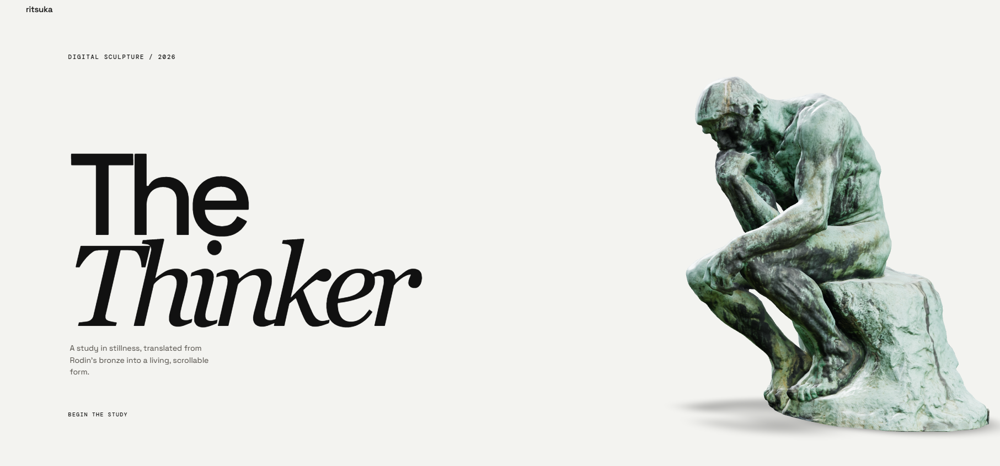

<h1 align="center">The Thinker Showcase</h1>

<p align="center">
  An interactive 3D showcase of <em>The Thinker</em>, built with React Three Fiber and Anime.js.
</p>

<p align="center">
  
  
  
</p>

<p align="center">
  
</p>

A small practice project exploring [React Three Fiber](https://r3f.docs.pmnd.rs) for rendering a 3D model in the browser and [Anime.js](https://animejs.com) for page and UI animation. The scene displays a model of *The Thinker* (`the thinker model.glb`) behind an animated landing page.

## Quick start

```bash
git clone https://github.com/ritsukasu/R3F-and-Anime.js-prac-The-Thinker-Showcase.git
cd R3F-and-Anime.js-prac-The-Thinker-Showcase/thinker-showcase
npm install
npm run dev
```

Then open the local URL printed in the terminal.

## Project structure

```text
.
├── thinker-showcase/        # The React app
├── landing-page.png         # Landing page screenshot
└── the thinker model.glb    # 3D model of The Thinker
```

## Built with

- [React Three Fiber](https://r3f.docs.pmnd.rs) for the 3D scene
- [Anime.js](https://animejs.com) for animation
- A `.glb` model of *The Thinker*

## License

No license has been added yet.
